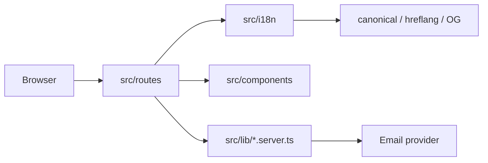

# JGM Construções

Website institucional multilingue da **JGM Construções** (marca comercial da JGM - Remodelações e Pinturas, Unipessoal Lda.), com experiência visual de construção progressiva durante o scroll.

Objetivo do produto: apresentar serviços de construção e remodelação com rigor factual, receber pedidos de orçamento e funcionar em português de Portugal, inglês e espanhol.

## Arquitetura (visão geral)



- **SSR:** TanStack Start + TanStack Router + React 19 + TypeScript
- **Build:** Vite 8 / Nitro (preset Lovable)
- **Estilos:** Tailwind CSS 4
- **Testes:** Vitest + Testing Library
- **Sem base de dados:** pedidos vão por email transacional configurável

## Requisitos

- Node.js **24.x** (`engines` em `package.json`)
- npm 10+ (o projeto declara `packageManager`)

## Instalação e execução local

```sh
npm install
cp .env.example .env.local
npm run dev
```

Abrir a URL do Vite e validar `/pt` (padrão). `/` redireciona para `/pt`.

## Scripts

| Script | Função |
| --- | --- |
| `npm run dev` | Servidor de desenvolvimento |
| `npm run build` | Build de produção |
| `npm run preview` | Preview no modo production |
| `npm run typecheck` | TypeScript |
| `npm run lint` | ESLint |
| `npm run test` | Vitest (uma passagem) |
| `npm run test:watch` | Vitest em watch |
| `npm run check` | typecheck + lint + test + build |
| `npm run format` | Prettier |

## Variáveis de ambiente

Ver `.env.example`. Resumo:

- `EMAIL_PROVIDER`, `EMAIL_API_KEY`, `EMAIL_FROM`, `CONTACT_RECIPIENT` — envio do formulário (servidor)
- `RECRUITMENT_RECIPIENT` — candidaturas textuais (sem upload de CV)
- `VITE_SITE_URL` — origem canónica pública (única `VITE_*` necessária no dia a dia)
- `TURNSTILE_*` — reservado

Sem as variáveis de email, o formulário mostra **erro**, nunca sucesso simulado.

Detalhes: [`docs/DEPLOYMENT-AND-ENVIRONMENT.md`](docs/DEPLOYMENT-AND-ENVIRONMENT.md).

## Idiomas e conteúdo

- Rotas: `/pt`, `/en`, `/es`
- Conteúdo: `src/i18n/content.ts` e `src/i18n/extended-content.ts`
- Guia editorial: [`docs/CONTENT-AND-BRAND-GUIDE.md`](docs/CONTENT-AND-BRAND-GUIDE.md)
- SEO/i18n: [`docs/I18N-AND-SEO.md`](docs/I18N-AND-SEO.md)

## Documentação

| Documento | Conteúdo |
| --- | --- |
| [`docs/ARCHITECTURE.md`](docs/ARCHITECTURE.md) | Módulos, fluxos, animação |
| [`docs/PROJECT-STRUCTURE.md`](docs/PROJECT-STRUCTURE.md) | Pastas e ficheiros críticos |
| [`docs/DEVELOPMENT-GUIDE.md`](docs/DEVELOPMENT-GUIDE.md) | Onboarding de desenvolvimento |
| [`docs/I18N-AND-SEO.md`](docs/I18N-AND-SEO.md) | Idiomas, metadados, sitemap |
| [`docs/DEPLOYMENT-AND-ENVIRONMENT.md`](docs/DEPLOYMENT-AND-ENVIRONMENT.md) | Ambientes e release |
| [`docs/QUALITY-AND-TESTING.md`](docs/QUALITY-AND-TESTING.md) | Como validar |
| [`docs/DECISIONS.md`](docs/DECISIONS.md) | Decisões e trade-offs |
| [`docs/CONTENT-AND-BRAND-GUIDE.md`](docs/CONTENT-AND-BRAND-GUIDE.md) | Voz, tom, critérios de copy |
| [`docs/OPEN-QUESTIONS.md`](docs/OPEN-QUESTIONS.md) | Factos a confirmar com o cliente |
| [`docs/CHANGELOG.md`](docs/CHANGELOG.md) | Alterações desta transformação |
| [`docs/AUDIT.md`](docs/AUDIT.md) | Auditoria técnica |
| [`docs/BRAND.md`](docs/BRAND.md) | Identidade visual |
| [`docs/OPERATIONS.md`](docs/OPERATIONS.md) | Operação / incidentes |
| [`docs/ROADMAP.md`](docs/ROADMAP.md) | Evolução faseada |

## Problemas comuns

| Sintoma | Causa provável | Ação |
| --- | --- | --- |
| Formulário sempre em erro | Variáveis de email em falta | Preencher `.env.local` / secrets do host |
| OG com URL errado | `VITE_SITE_URL` desatualizado | Alinhar com o domínio do deploy |
| Mapa não aparece | Consentimento de externos | Aceitar no banner ou “carregar mapa” |
| Typecheck falha após editar copy | Campo em falta numa língua | Completar `pt`/`en`/`es` no mesmo tipo |
| Animação “pesada” | Preferência de movimento | Ativar reduce motion no SO — o site fica estático no estágio final |

## Contribuir

1. Ler [`docs/DEVELOPMENT-GUIDE.md`](docs/DEVELOPMENT-GUIDE.md) e o guia de conteúdo.
2. Não inventar factos empresariais ([`OPEN-QUESTIONS.md`](docs/OPEN-QUESTIONS.md)).
3. Manter as três línguas sincronizadas.
4. Correr `npm run check` antes de pedir revisão.
5. Não commitar `.env*`, `.output/` nem segredos.

## Privacidade e segurança (resumo)

- Mapa Google só após consentimento.
- Validação Zod no servidor, honeypot, limites de tamanho, timeout.
- Sem armazenamento de pedidos em BD no projeto atual.
- Políticas legais presentes mas **sujeitas a revisão jurídica** antes do lançamento.
