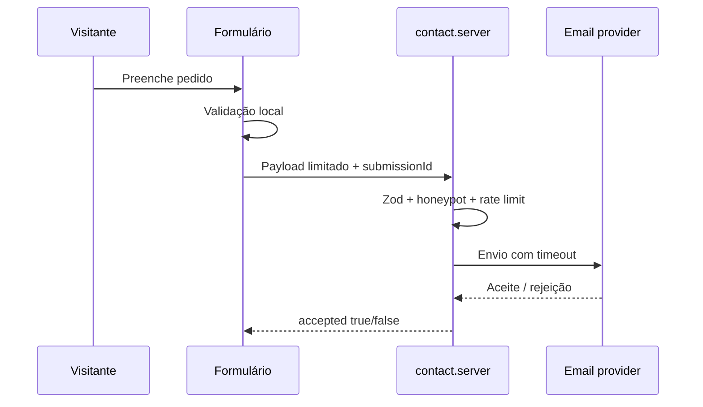

# Arquitetura do website

## Objetivo

Website institucional SSR da JGM Construções, orientado a conversão, SEO (com sede comunicada em Coimbra sem limitar artificialmente o mercado) e apresentação visual premium. A arquitetura evita base de dados enquanto os únicos fluxos de dados forem contacto e manifestação de interesse profissional.

Documentação complementar: [`PROJECT-STRUCTURE.md`](PROJECT-STRUCTURE.md), [`DECISIONS.md`](DECISIONS.md), [`CONTENT-AND-BRAND-GUIDE.md`](CONTENT-AND-BRAND-GUIDE.md).

## Módulos

- `src/routes/`: rotas TanStack Start, páginas e metadados.
- `src/components/site.tsx`: header, footer, heróis, FAQ e componentes estruturais.
- `src/components/consent.tsx`: preferências locais e controlo de conteúdo externo.
- `src/i18n/content.ts`: navegação, homepage, serviços e helpers de URLs/SEO.
- `src/i18n/extended-content.ts`: legais, consentimento, carreiras e blog.
- `src/lib/*.server.ts`: funções exclusivamente server-side para email.
- `src/lib/*-schema.ts`: contratos Zod partilhados entre UI e servidor.
- `src/config/site.ts`: domínio, URLs oficiais e ano inicial.
- `src/config/brand.ts` + `docs/BRAND.md`: paleta e regras da identidade visual.
- `src/assets/brand/`: logótipo completo e emblema com fundo transparente.
- `public/`: descoberta SEO, favicon, OG, identidade web e manifest.

## Routing

`/` redireciona para `/pt`. Todas as páginas públicas vivem sob `/{lang}`, com `pt`, `en` e `es`. Os slugs são mapeados por uma chave semântica, permitindo que o seletor de idioma encontre a página equivalente sem depender do texto do URL atual.

As rotas dinâmicas distinguem:

- páginas institucionais: `/{lang}/{page}`;
- serviços: `/{lang}/{services}/{service}`;
- artigos: `/{lang}/blog/{article}`.

Slugs inválidos originam 404; não são geradas páginas vazias.

## Fluxo de contacto

1. O browser valida para melhorar a experiência.
2. A server function recebe um objeto limitado e volta a validá-lo com Zod.
3. Honeypot, UUID de submissão, janela de frequência e limites reduzem abuso.
4. O servidor escolhe um destinatário fixo a partir do ambiente.
5. O conteúdo é escapado e enviado ao fornecedor com timeout.
6. Só uma resposta aceite pelo fornecedor produz confirmação na UI.

Não existe armazenamento persistente. O limite em memória é complementar; a proteção global deve ser aplicada no edge.

## Segurança e fronteiras de confiança

- Dados do browser nunca são considerados confiáveis.
- Variáveis `VITE_*` são públicas; só `VITE_SITE_URL` e a futura site key anti-bot podem usá-las.
- Chaves, remetentes e destinatários são privados e lidos apenas no servidor.
- Currículos e uploads não são aceites.
- O mapa é um conteúdo externo e só é criado depois de consentimento.
- CSP e headers são aplicados no wrapper da resposta SSR.

## Animação da construção

Quatro imagens locais representam fundação, estrutura, envolvente e conclusão. O progresso é calculado apenas dentro da narrativa da homepage, não em toda a página. Crossfade e parallax são atualizados por `requestAnimationFrame`. Com `prefers-reduced-motion`, a apresentação fica estática no edifício concluído.

Os assets `src/assets/stage-*.jpg` são parte funcional da experiência e não devem ser removidos sem substituir a sequência completa.

## Fluxo de pedido (visão)

## Decisões de evolução

- Adicionar base de dados apenas quando existir uma necessidade real de histórico, workflow ou recuperação.
- Adicionar CMS apenas quando a frequência/editorial do blog justificar autenticação, preview e publicação.
- Adicionar uploads de CV apenas com armazenamento privado, análise antimalware, acesso temporário e eliminação automática.
- Manter integrações externas atrás de consentimento e configuração central.
- Confirmar área de intervenção e serviços operacionais antes de alargar claims de SEO local ([`OPEN-QUESTIONS.md`](OPEN-QUESTIONS.md)).
