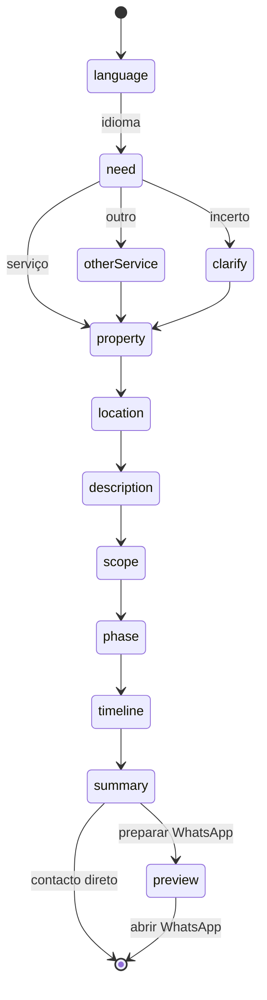

# Assistente comercial, WhatsApp, cookies e redes sociais

Documentação do sistema implementado no website da JGM Construções. Descreve apenas o que existe no código.

## Visão geral

| Peça | Local | Função |
| --- | --- | --- |
| Preferências de cookies | `src/components/consent.tsx` | Banner inicial + painel + botão discreto (esquerda) |
| Textos de consentimento | `src/i18n/extended-content.ts` → `consent` | PT / EN / ES |
| Assistente comercial | `src/components/sales-assistant.tsx` | Widget inferior direito |
| Máquina de estados | `src/lib/assistant/machine.ts` | Transições determinísticas |
| Copy do assistente | `src/i18n/assistant-content.ts` | Perguntas, opções, WhatsApp |
| Mensagens WhatsApp | `src/lib/assistant/message.ts` + `src/lib/whatsapp.ts` | Texto + URL `wa.me` |
| Contactos oficiais | `src/config/contacts.ts` | Número e redes sociais |
| Redes no footer | `src/components/site.tsx` | Instagram e Facebook |

Montagem global (todas as rotas `/{lang}`): `src/routes/$lang.tsx`.

## Preferências de cookies

### O que o site guarda de facto

1. **Necessário:** preferência de consentimento em `localStorage` (`jgm-consent-v1`).
2. **Opcional:** autorização para carregar o mapa Google na página de contactos (`external: true|false`).

Não existem categorias de analytics, publicidade ou rastreadores no projeto. O painel não inventa opções fictícias.

### Fluxos

1. **Primeira visita:** banner “Preferências de cookies” (aceitar necessários + mapa / apenas necessários / personalizar).
2. **Depois de uma escolha:** banner fecha; aparece o botão discreto no canto inferior esquerdo (ícone de cookie, `aria-label` localizado).
3. **Reabrir:** botão esquerdo, ou “Preferências de cookies” no footer (`openConsentPreferences`).
4. **Retirar consentimento do mapa:** personalizar → desmarcar conteúdo externo → guardar (`external: false`). O mapa deixa de carregar sem recarregar a página inteira (evento `jgm-consent-change`).

O assistente comercial **não** depende do consentimento de cookies.

## Assistente comercial

### Princípios

- É um assistente virtual da JGM (não simula atendimento humano em tempo real).
- Fluxo guiado por opções; texto livre só onde é útil (outro serviço, localização, descrição, dimensão).
- Idioma da conversa escolhido no início; independente do idioma da página.
- Estado guardado em `sessionStorage` (`jgm-assistant-v1`) durante a sessão do separador — fecha e reabre sem perder respostas; não envia dados a servidores.
- Sem API de IA, sem base de dados.

### Máquina de estados



Passos: `language` → `need` → (`otherService` | `clarify`) → `property` → `location` → `description` → `scope` → `phase` → `timeline` → `summary` → `preview`.

Serviços listados = `SERVICE_IDS` do website (construção, LSF, remodelações, pintura, revestimentos, ETICS, estucagem, vidros, coberturas) + “outro” + “ainda não tenho a certeza”.

### Controlo do utilizador

- Voltar à pergunta anterior
- Reiniciar (mantém idioma se já escolhido)
- Mudar idioma (reinicia respostas)
- Fechar o painel (estado de sessão preservado)
- Contacto direto por WhatsApp (mensagem curta, sem questionário)
- Corrigir respostas a partir do resumo

### WhatsApp

- Número: `src/config/contacts.ts` → `whatsappE164Digits` = `351911040509` (apresentação `+351 911 040 509`).
- URL: `https://wa.me/351911040509?text=...` via `buildWhatsAppUrl`.
- Pedido completo: só inclui campos preenchidos; sem placeholders `[campo]`.
- Contacto direto: mensagem curta localizada (`whatsapp.direct`).
- Abrir o link **não** significa envio — a UI avisa que o envio só ocorre na app / WhatsApp Web.

Contacto direto também na página de contactos (`src/routes/$lang/$page/index.tsx`).

## Redes sociais

Configuradas em `CONTACTS.social` e espelhadas em `SITE_CONFIG.socialUrls`:

- Instagram: https://www.instagram.com/jgm_remodelacoes_e_pinturas/
- Facebook: https://www.facebook.com/profile.php?id=61560446386054

Footer: ícones Lucide com `aria-label` PT/EN/ES e `rel="noopener noreferrer"`. Incluídos em JSON-LD `sameAs` no root.

## Como alterar

### Nova pergunta / opção

1. Atualizar tipos em `src/lib/assistant/types.ts` se necessário.
2. Ajustar transição em `machine.ts`.
3. Adicionar copy nos três idiomas em `assistant-content.ts`.
4. Atualizar UI em `sales-assistant.tsx` se o passo for novo.
5. Se o campo for para o resumo/WhatsApp, atualizar `message.ts`.
6. Acrescentar teste em `src/test/assistant-and-consent.test.ts`.

### Novo idioma

1. Adicionar língua em `LANGS` / dicionários existentes (site inteiro).
2. Acrescentar bloco completo em `ASSISTANT_CONTENT`.
3. Incluir opção no passo `language` do assistente.
4. Traduzir `EXTRA_CONTENT[lang].consent` e `footer.instagram` / `facebook`.

### Mudar número WhatsApp ou redes

Editar apenas `src/config/contacts.ts`. O resto do site lê essa configuração.

## Como testar

```sh
npm run test -- src/test/assistant-and-consent.test.ts
npm run check
```

Manual (browser):

1. Perfil limpo → banner de cookies → guardar → botão esquerdo reabre painel → desmarcar mapa → guardar.
2. Assistente → escolher EN → verificar que todas as perguntas ficam em inglês → voltar / reiniciar / contacto direto.
3. Fluxo completo PT → resumo só com dados dados → pré-visualizar mensagem → abrir WhatsApp (validar número e texto).
4. Footer → Instagram e Facebook → perfis corretos.
5. `/pt`, `/en`, `/es` → controlos e labels no idioma da página (exceto conversa do assistente após escolha).

## Auditoria QA (outubro 2026)

Ambiente: `npm run dev` em `127.0.0.1` (não produção). Ver relatório em canvas e `docs/CHANGELOG.md`.

### Corrigido nesta auditoria

1. **Scroll do assistente em ecrãs estreitos** — `min-h-0` no painel; opções deixaram de ficar sob o rodapé.
2. **Voltar da pré-visualização** — `jumpToStep` bloqueava o regresso ao resumo; corrigido + `goBack` no botão.
3. **Telefone no JSON-LD** — alinhado a `whatsappTelUri()` / `CONTACTS` (já não hardcoded).
4. **Flash do banner de cookies no SSR** — painel só após montagem no cliente quando a escolha já existe.
5. **Label do FAB** — ao fechar, usa o idioma da conversa.

### Verificado no browser (local)

- Fluxos PT / EN / ES até pré-visualização WhatsApp e `window.open` com URL correta.
- Campos opcionais omitidos; acentos e quebras preservados na URL.
- Consentimento: reabrir, ativar mapa (iframe), retirar (iframe removido).
- Persistência `sessionStorage` ao fechar/reabrir e ao mudar de rota.
- Controlos em 320 / 390 / 1440 sem sobreposição nem scroll horizontal.

### Não verificado integralmente

- Entrega real de mensagens no WhatsApp da empresa (titularidade / inbox).
- Titularidade dos perfis Instagram/Facebook além da URL configurada.
- Conformidade jurídica do consentimento.
- Produção / CDN / dispositivos físicos reais.

## Limitações conhecidas

- O assistente não confirma envio da mensagem WhatsApp (não há webhook).
- Não há disponibilidade em tempo real nem promessa de prazo de resposta.
- Área de intervenção geográfica continua a ser confirmada pela equipa (ver `docs/OPEN-QUESTIONS.md`).
- Políticas legais sujeitas a revisão jurídica.
- Não publicar automaticamente em produção nesta passagem.

## Dependências da empresa (atualizadas)

Confirmados e implementados:

- WhatsApp oficial
- Instagram e Facebook oficiais

Ainda em aberto (não bloqueiam este sistema): email de produção, Google Reviews, área de intervenção formal, revisão jurídica.
